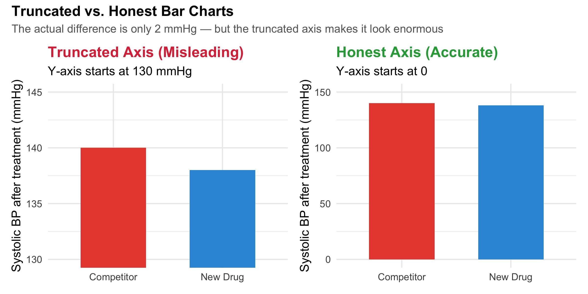

# Fundamentals of Data Visualization{.bkrd-color-1}

## From technical to theoretical 

:::{.box-1-list}
Last week, we focused on the *technical* side of creating visualizations with `ggplot2`. Now comes the harder part: making the plot—and its message connect with you and your audience.
:::

- Choose an effective way to display the data.
- Make the important patterns easy to see.
- Avoid design choices that distract or mislead.

::: {.callout-tip}
A random member of your target audience should be able to understand the main message of your figure without having to ask you questions or dive into the code/methods to understand it.
:::

## Basic principles of effective visualization

:::{.box-1-list}
There are no universal rules that guarantee a perfect plot, but a few principles help us make better decisions:
:::

1. Use color deliberately.
2. Keep visual encodings proportional to the values they represent.
3. Reduce the work required to interpret a figure.
4. Balance data elements with supporting context.
5. Prefer clarity and simplicity over decoration.

These ideas are adapted largely from Claus Wilke's *Fundamentals of Data Visualization*.

## 🎨 Use color deliberately

Different kinds of information call for different kinds of color scales.

::: {.columns}
::: {.column width="50%"}
**Qualitative**

Use to distinguish discrete groups with no inherent order.

{fig-align="center" width="95%"}

Examples: species, habitat types, or treatments.
:::
::: {.column width="50%"}
**Sequential**

Use to represent values along an ordered, continuous scale.

{fig-align="center" width="95%"}

Examples: temperature, precipitation, or abundance.
:::
:::

## 🎨 Use color deliberately
Use a **diverging** scale when values depart in two directions from a meaningful midpoint—often zero.

{fig-align="center" width="70%"}

## Color can also highlight...

:::{.box-1-list}
**Accent** colors draw attention to a particular category, observation, or value.
:::

{fig-align="center" width="75%"}


## ...but don't overdo it
:::{.box-1-list}
A common pitfall is encoding too much information with color.
:::

- Qualitative palettes become difficult to distinguish when they contain many categories.
- As a rough rule, more than ~8 distinct colors can overwhelm the reader.
- When individual observations matter, consider **direct labels** instead of adding more colors.

## Example of "overcoding" your color:

:::{.box-1-list}
Here, each of 12 bird species is assigned a different color. The plot contains useful information, but the legend and overlapping colors make comparisons harder.
:::

```{r}
library(tidyverse)

set.seed(123)

species <- tibble(
  species = paste("Species", LETTERS[1:12]),
  guild = rep(c("Canopy", "Understory", "Generalist"), each = 4)
)

bird_data <- expand_grid(
  site = paste0("Site_", 1:20),
  habitat = c("Old-growth", "Secondary", "Regrowth", "Plantation"),
  species = species$species,
  season = c("Spring", "Summer", "Fall")
) |>
  left_join(species, by = "species") |>
  mutate(
    habitat_effect = case_when(
      habitat == "Old-growth" ~ 18,
      habitat == "Secondary" ~ 14,
      habitat == "Regrowth" ~ 10,
      habitat == "Plantation" ~ 6
    ),
    species_effect = match(species, unique(species)) %% 4 * 2,
    season_effect = case_when(
      season == "Spring" ~ 3,
      season == "Summer" ~ 6,
      TRUE ~ 1
    ),
    abundance = rpois(
      n(),
      lambda = habitat_effect + species_effect + season_effect
    )
  )

ggplot(bird_data, aes(habitat, abundance, color = species)) +
  geom_jitter(width = 0.2, alpha = 0.8, size = 2.5) +
  scale_color_brewer(palette = "Paired") +
  labs(
    title = "Bird abundance across forest habitats",
    subtitle = "Each species is assigned a different color",
    x = "Forest habitat",
    y = "Bird abundance",
    color = "Species"
  ) +
  theme_minimal(base_size = 12)
```

::: {.callout-tip}
Could guild, habitat, or a small number of focal species tell the story more clearly? Or perhaps we need to *facet* our plot
:::

## The principle of proportional ink

:::{.box-1-list}
When values are represented by physical dimensions—bar length, bubble area, map area, and so on—the amount of visual “ink” should be proportional to the data value. **Why does this matter?**
:::

- Visual differences should reflect numerical differences.
- Graphs should not exaggerate differences.
- Relative magnitudes should be intuitive to compare.

{fig-align="center" width="90%"}

::: {.callout-caution}
This example also omits variation around the mean systolic blood pressure. A mean alone tells us little about how consistent values are among the samples.
:::

## Design figures so they don't need a legend

:::{.box-1-list}
Legends make readers move back and forth between the plot and its key. Whenever possible, reduce that effort.
:::

::: {.columns}
::: {.column width="50%"}
**Legend required**

{width="100%"}
:::
::: {.column width="50%"}
**Direct labeling**

{width="100%"}
:::
:::

Other strategies include:

- Labeling groups or lines directly.
- Using axes and facets to identify groups.
- Avoiding redundant aesthetic mappings when they do not add useful information.

## Balance data and non-data elements

:::{.box-1-list}
A figure needs enough context to be interpretable—but not so much that the context competes with the data. Figures can include too much **non-data ink**.
:::

{fig-align="center" width="72%"}

Axes, grid lines, borders, and other elements can distract from the pattern.

## Balance is not the same as removing everything
:::{.box-1-list}
Removing too much can make a figure harder to interpret or strip away useful context.
:::

{fig-align="center" width="72%"}

:::{.callout-important}
There is no hard-and-fast formula. Developing a sense of balance takes practice, comparison, and feedback.
:::

## ✂️ Simplicity, simplicity, simplicity!
:::{.box-1-list}
A simple visualization that communicates one central message is usually better than a complex figure that muddies that message. A few practical guidelines:
:::

- **Avoid gratuitous 3D.** Two dimensions are usually easier to interpret.
- **Don't encode everything.** Just because a variable is available does not mean it belongs in the plot.
- **Make the message visible at a glance.** Titles and captions should help readers understand the main takeaway.
- **Build toward complexity.** In presentations, orient the audience with simpler views before showing a complex figure.
- **Be consistent, not repetitive.** Choose the plot that best suits each question.
- **Build figures for the CEO.** Assume your reader is busy and needs to understand the point quickly.

# Exploratory Data Analysis{.bkrd-color-3}

## Exploratory data analysis (EDA)
:::{.box-3-list}
After cleaning and wrangling, **exploratory data analysis** is our next step toward understanding how a dataset is structured and what it contains. EDA helps us:
:::

- **Summarize main characteristics:** group means, variation, spread, distributions, and more.
- **Spot anomalies:** unusual observations, outliers, or miscoded data.
- **Find patterns:** expected relationships and unexpected signals that may reflect biology—or systematic bias.

EDA is useful for both observational datasets and carefully designed experiments.

## EDA is an iterative process
:::{.box-1-list}
There is no single formal protocol, but a useful way to think about EDA is as a cycle:
:::

1. **Generate questions** about your data.
2. **Search for answers** by visualizing, transforming, and sometimes modeling your data.
3. **Use what you learn** to refine your questions or generate new ones.

::: {.callout-note}
EDA is not just a box to check before analysis. It is a way to learn what your data can—and cannot—tell you.
:::

## ✅ EDA checklist: understand the data

| Activity | Questions to ask |
|:--|:--|
| **Dataset structure** | What are my observations? What does each row represent? |
| **Distributions** | How are variables distributed? Skewed, bimodal, or approximately normal? |
| **Missing data** | Where and why are observations missing? Is missingness associated with groups, sites, or dates? |
| **Sample sizes** | Are observations balanced across groups, treatments, or locations? |
| **Variation** | How much variability exists within and among groups? |
| **Outliers** | Are unusual observations errors, measurement artifacts, or meaningful biological variation? |

## ✅ EDA checklist: look for patterns and context

| Activity | Questions to ask |
|:--|:--|
| **Relationships** | Are variables related? Are relationships linear, nonlinear, or absent? |
| **Temporal patterns** | Are there seasonal, annual, or other temporal trends? |
| **Spatial patterns** | Are observations spatially clustered? Are there geographic patterns? |
| **Sampling bias** | Could sampling effort, detectability, or methodology explain observed patterns? |
| **Transformations** | Would transforming variables or using alternative summaries reveal patterns? |
| **Experimental design** | Does the data structure reflect blocks, sites, repeated measures, or other dependencies? |
| **Biological interpretation** | Are patterns biologically meaningful, or could they reflect artifacts or confounding? |
| **New questions** | What unexpected patterns emerged? What should I investigate next? |

::: {.callout-important}
If data come from a carefully designed experiment (e.g., a randomized complete block design), analysis must remain consistent with how the data were collected. EDA can generate additional questions, but it should not override the experimental design.
:::

# A bestiary of plots{.bkrd-color-4}

## A bestiary of plots
:::{.box-4-list}
There are a *lot* of ways to display data—and often more than one reasonable choice. A good way to brainstorm is to look at examples:
:::

- What kind of data are being displayed?
- What comparison or pattern does the plot make easy to see?
- Which aesthetics and geoms are doing the work?

The examples on the next slides are from Claus Wilke's [*Fundamentals of Data Visualization*](https://clauswilke.com/dataviz/directory-of-visualizations.html), Chapters 5–16.

## 📊 Plot families: amounts, distributions, and proportions

::: {.columns}
::: {.column width="50%"}
**Amounts**

{width="100%"}

{width="100%"}
:::
::: {.column width="50%"}
**Distributions**

{width="100%"}

{width="100%"}
:::
:::

## 📊 Plot families: proportions and uncertainty

::: {.columns}
::: {.column width="50%"}
**Proportions**

{width="100%"}

{width="100%"}
:::
::: {.column width="50%"}
**Uncertainty**

{width="100%"}

{width="100%"}
:::
:::

::: {.callout-important}
Whenever you plot a mean—whether from a basic summary or a model—also show uncertainty. Examples include **standard deviations**, **standard errors**, and **confidence or credible intervals**.
:::

## 📈 Plot families: relationships and space

::: {.columns}
::: {.column width="50%"}
**X–Y relationships**

{width="100%"}

{width="100%"}
:::
::: {.column width="50%"}
**Geospatial data**

{width="100%"}
:::
:::

Explore the [directory of visualizations](https://clauswilke.com/dataviz/directory-of-visualizations.html) when you are unsure which plot type might work best.

## 🧠 Take-home points

- **Color should have a job.** Match the scale to the kind of information.
- **Don't mislead.** Keep visual encodings proportional and show uncertainty around summaries.
- **Reduce interpretation effort.** Direct labels and thoughtful design can make legends unnecessary.
- **Keep the figure balanced and simple.** Show what matters, with enough context to understand it.
- **Use EDA to learn.** Inspect structure, distributions, missingness, variation, relationships, and design.
- **Choose plots to answer questions.** The best plot is the one that communicates the data clearly.

**Further reading:** [Fundamentals of Data Visualization](https://clauswilke.com/dataviz/) · [R for Data Science: Exploratory Data Analysis](https://r4ds.hadley.nz/EDA.html) · [R Graph Gallery](https://r-graph-gallery.com/)
