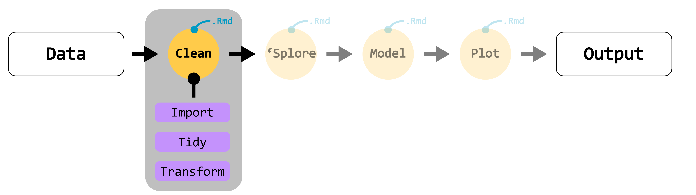

:::: content-callout1
## Readings

-  [R for Data Science (2e) was written by Hadley Wickham, Mine Çetinkaya-Rundel, and Garrett Grolemund. Chapter 3: Data transformation](https://r4ds.hadley.nz/data-transform.html)
-  [R for Data Science (2e) was written by Hadley Wickham, Mine Çetinkaya-Rundel, and Garrett Grolemund. Chapter 5: Data tidying](https://r4ds.hadley.nz/data-tidy.html)
-  [R for Data Science (2e) was written by Hadley Wickham, Mine Çetinkaya-Rundel, and Garrett Grolemund. Chapter 7: Data import](https://r4ds.hadley.nz/data-import.html)

### Online/optional extras

-  [Tidy Data: Data Carpentry](https://datacarpentry.github.io/semester-biology/materials/tidy-data/)

## Questions we'll address this week

1.  What is Tidy data? How do we get our data Tidy?
2.  How do we import data into R?
3.  How can we transform our data to model and report?

## Slides

[ Open slides in full screen mode](slides/w5-slides.html){.btn .btn-primary role="button"} [ Download slides as a PDF](slides/w5-slides.html?print-pdf){.btn .btn-primary role="button"}

<iframe src="slides/w4-slides.html" width="100%" height="500px" style="border: 1px solid #ccc; border-radius: 8px;">

</iframe>

::: callout-tip
**Tip**: If you type <kbd>?</kbd> (or <kbd>shift</kbd> + <kbd>/</kbd>) while going through the slides, you can see a list of special slide-specific commands.
:::
::::

</br>

```{r include=FALSE}
library(tidyverse)
```

##  Data wranglin'

In many of your statistics courses so far, you've probably worked a lot with very clean, ready-to-analyze data to emphasize learning statistical concepts over data handling. *However, We're all biologists or ecologists working with biological and ecological data, which are rarely as neatly packaged*. We'll often need to clean things up, get rid of problematic or missing observations, or create new variables/impute missing data.

When it comes to analyzing data, 75% or more of your time will be taken up collating, recording, arranging, and tidying your data in preparation for the actual statistical analysis. This process I call **data wrangling** or **data cleaning**. These steps are as crucial as your analsyes: misteps when wrangling your data into shape can result in ommitting or including data incorrectly, calculating incorrect summaries or new variables. The wrangling steps are also the least documented in the literature or when people publish the code for their analyses; they'll often just include the statistical treatise but not how the data went from raw --\> ready to analyze. This is a mistake, and a lot can be hidden by not including the details of how your data are prepared.

We'll discuss the three basic steps of data wrangling today and next week: **importing**, **tidying**, and **transforming** data.

## 

</br>

## 💾 Importing data: the `readr` package

The first step in data wranglin' is to actually get data into R! This process is usually pretty trivial if you are working with well-created and maintained tabular data, but can sometimes be frustrating if your data files contain mistakes that cause variables/columns to get imported as incorrect atomic data types (recall [atomic data](https://entomology-3927-5927.github.io/entomology-3927/content/w2-content.html#the-atomic-data-types) from week 2!).

### Importing from files

Most folks will need to import data from files saved in your project. Here, I assume you have saved your files in your project's working directory (inside your `data/raw/` folder, for example), and all of my file pathing will reflect that assumption.

Taking a look at our [`readr`](https://github.com/rstudio/cheatsheets/blob/main/data-import.pdf) cheat sheet, we can see that we have several functions that allow us to import data files:

1.  `read_csv()`: importing comma separated value files (most common for tabular data)
2.  `read_delim()`: importing text-delimited files of any kind

We'll mostly be using `read_csv()`. For example:

```{r eval=FALSE}
my.data.df <- read_csv(
    "./data/raw/raw-data.csv",
    col_names = TRUE
)
```

When you import data using any of the `read_*()` functions, the function will automatically try to guess whether you have column names as part of your data, what the proper text delimiter is, and what the type of atomic data each column represents (logical, numeric, character). Usually, it does a very good job of this, but if you have any mistakes in your recorded data (comma instead of decimal point, text in a column that otherwise contains numbers), it may import the data with the columns incorrectly classified, and that will create issues down the line when you want to plot, model, or work with these data. Given this, it's important that we immediately check our imported data for issues. We can do this by calling `str()` (short for *structure*) or using the tidyverse `glimpse()` function to give us a summary of our imported data and inspect it for issues.

Alternatively, if you know your data structure we can explcitly tell the `read_*()` function what your columns should be by passing it a vector of the data types:

```{r eval=FALSE}
my.data.df <- read_csv(
    "./data/raw/raw-data.csv",
    col_names = TRUE, 
    col_types = c("c", "c", "n", "n", "f")
)
```

In this code, we're telling R that our imported data has 5 columns that are, in order, character, character, numeric, numeric, and factor atomic data. This will force these columns to parse the data in this format, but it will throw a warning to you indicating that there was a parsing error:

```{r}
bees <- read_csv(
  "./content_data/w5/bees.csv",
  col_types = cols(
    site = col_character(),
    bumble_bees = col_double()
  )
)

bees

problems(bees)
```

### Importing from Google Sheets

We'll spend more time on importing data from the internet a bit later in the course, but for now, it's important that we discuss Google Sheets because many people likely use it to record data from experiments. I highly recommend this, because we have tools that allow us to import directly from your online sheet without having to download `.csv` files anytime something changes. This eliminates busy work and makes our workflows more easily reproducible.

The syntax for importing from Google Sheets is similar, we just need to give it details about the sheet ID and sheet name we wish to import from:

```{r include=FALSE}
set.seed(3927)
library(googlesheets4)
library(googledrive)

pollinators <- tibble(
  site = sample(sprintf("Site_%02d", 1:20), 200, replace = TRUE),
  habitat = sample(
    c("prairie", "restored_prairie", "bee_lawn", "crop_edge"),
    200, replace = TRUE
  ),
  species = sample(
    c("Bombus_impatiens",
      "Bombus_griseocollis",
      "Bombus_bimaculatus",
      "Apis_mellifera",
      "Halictus_rubicundus"),
    200, replace = TRUE
  ),
  temperature_C = round(rnorm(200, 24, 4), 1),
  flowers_per_m2 = round(runif(200, 5, 80), 1),
  bee_count = sample(0:25, 200, replace = TRUE),
  survey_minutes = sample(c(10, 15, 20, 30), 200, replace = TRUE)
)

# gs4_deauth()
# drive_deauth()
# gs4_auth(
#    scopes = c(
#      "https://www.googleapis.com/auth/spreadsheets",
#      "https://www.googleapis.com/auth/drive"
#    )
# )

# drive_auth(
#    scopes = c(
#      "https://www.googleapis.com/auth/spreadsheets",
#      "https://www.googleapis.com/auth/drive"
#    )
# )

# Create sheet
# ss <- gs4_create("gs4-import")
# folder <- drive_find(type = "folder", pattern = "example-data", n_max = 1)

# # Move it to the desired Google Drive folder
# drive_mv(
#    file = ss,
#    path = folder
# )

# sheet_write(
#   data = pollinators,
#   ss = ss
# )
```

```{r eval=FALSE}
library(googlesheets4)
library(googledrive)
# Using full URL
read_sheet("https://docs.google.com/spreadsheets/d/1pmjuATrm7_PCOvlr9HwYsNfBG9d7SApBM87Y0wcQOyk/edit?gid=780380257#gid=780380257")

# Using sheet ID only
read_sheet(
  "1pmjuATrm7_PCOvlr9HwYsNfBG9d7SApBM87Y0wcQOyk",
  sheet = "pollinators" # Name of the sheet or tab in the spreadsheet if there are multiple
  )

# a googledrive "dribble" (this is a way to search and get the "access code" for the file in your drive)
googledrive::drive_get("gs4-import") %>% 
  read_sheet()
```

::: callout-note
# Need to authenticate!

In order to access files in your Google Drive, you'll need to authenticate your RStudio session to access your drive. Use the `gs4_auth()` function for that and follow the web prompts to authorize.
:::

### Doing quick data cleaning on imported files: the `janitor` package

Once we import our data, we can do a few quick things to clean it up and standardize it. The `janitor` package has some really helpful functions to go through messy column names and clean them up. Notice how in our dataset below, we have column names that don't adhere to the data naming conventions we discussed in week 2. The names have special characters, spaces, and all sorts of shenanigans:


```{r include=FALSE}
messy.names.df <- tibble(
  `Specimen ID#`           = c("PLANT_001", "PLANT_002", "PLANT_003", "PLANT_004", "PLANT_005"),
  ` Genus & Species `      = c("Arabidopsis thaliana", "Solanum lycopersicum", "Arabidopsis thaliana", "Zea mays", "Solanum lycopersicum"),
  `Leaf Area (cm^2)`       = c(12.4, 45.2, 10.8, 112.0, 38.6),
  `Leaf Area (cm^2)`       = c(12.1, 44.8, 11.2, 110.5, 39.1), # Duplicated column name (e.g., technical replicate)
  `Chlorophyll_a+b (ug/mg)` = c(2.1, 1.8, 2.4, 3.1, 1.6),
  `Soil pH`                = c(6.5, 5.8, 6.7, 6.2, 5.9),
  `Percent_NDVI (%)`       = c(0.72, 0.65, 0.78, 0.85, 0.61),
  `DATE collected!`       = c("2026-05-10", "2026-05-10", "2026-05-11", "2026-05-11", "2026-05-12"),
  ` Notes / Comments `     = c("healthy", "mild chlorosis", "healthy", "damaged leaf", "pest presence"),
  .name_repair = "minimal"
)

write_csv(
  messy.names.df,
  "content_data/w5/messy-names.csv"
)
```

```{r}
messy.names.df
names(messy.names.df)
```

```{r message=FALSE, warning=FALSE}
library(janitor)

clean.names.df <- clean_names(messy.names.df)

names(clean.names.df)
```

We can also use the **pipe** to combine reading our data in and cleaning up the names into a single step!

```{r}
clean.names2.df <- read_csv("content_data/w5/messy-names.csv") |>
  janitor::clean_names()
clean.names2.df 
```

------------------------------------------------------------------------

</br>

## 🧹 Tidy data: the `tidyr` package

The second step in our data wranglin' is to get our data **tidy**. This isn't just a euphamism, but an acutal data theory spearheaded by Hadley Wickham and the RStudio/Positron development team. A dataset is tidy when it meets these three criteria:

1.  **Each variable is a column:** variables measure same attribute across different units
2.  **Each observation is a row:** an observation contains all the values measured on a single unit across all variables
3.  **Each value is a cell:** every cell contains single, discrete measurement or value


Getting your data into this structure is not just for kicks. It (1) provides a standardized, consistent way to store data that anyone can pick up and use and (2) it plays very nice with R's vectorized nature (remember back to week 2 where we talked about vectorized functions). Much of the time, the way that we collect and record data is *not* aligned with the Tidy method. So, how do we get our data to be tidy?

### Lengthening data

The most common way we have to manipulate a raw data source to make it tidy is to *lengthen* it. We lengthen data when folks have recorded variable names as column headers. For example:

```{r include=FALSE}
# Create a reproducible, larger wide dataset
set.seed(123)

tree.count.df <- tibble(
  site_id = rep(paste0("Plot_", sprintf("%02d", 1:5)), each = 2),
  year = rep(c(2023, 2024), times = 5),
  habitat_type = rep(c("Upland", "Riparian", "Wetland", "Upland", "Riparian"), each = 2),
  soil_ph = round(runif(10, 4.8, 7.2), 1),
  canopy_cover_pct = round(runif(10, 35, 90), 0),
  # Wide species abundance columns
  oak_count = sample(0:15, 10, replace = TRUE),
  maple_count = sample(0:22, 10, replace = TRUE),
  pine_count = sample(0:10, 10, replace = TRUE),
  birch_count = sample(0:14, 10, replace = TRUE),
  cedar_count = sample(0:8, 10, replace = TRUE)
)
```

```{r}
tree.count.df
```

Here, we have a tibble that records data on tree counts in different plots and habitats. Rather than recording each observation as a single row, we have multiple species counts contained in a single row. That is to say, we have "wide" data. If we wanted to plot all of our species in a single figure, the current format wouldn't allow us to easily do that as there are 5 columns containing species abundances. What we can do, is **pivot** this into a "long" dataset that is tidy using the `pivot_longer()` function in the `tidyr` package:

```{r}
tree.count.tidy.df <- tree.count.df %>%
  pivot_longer(
    cols = ends_with("_count"),     # Select only the species count columns
    names_to = "species",           # Name of the new column for species names
    values_to = "abundance"         # Name of the new column for counts
  ) %>%
  mutate(species = str_remove(species, "_count")) # Clean up the "_count" suffix

tree.count.tidy.df
```

There are 3 key arguments to this function:

1.  `cols`: specifies the columns that need to be "pivoted" (which columns are NOT variables)
2.  `names_to`: how we want to name the variable stored as column names. Here, `species`
3.  `values_to`: how we want to name the variable stored as values. Here, `abundance`

Excellent! We now have our data in tidy form and ready to plot, model, or do whatever else we'd like to do with it. Visually, this is how this pivot is working out:

{fig-align="center" width="60%"} {fig-align="center" width="60%"} {fig-align="center" width="60%"}

### Widening data

The second most common way we have to manipulate a raw data source to make it tidy or compatible with certain data packages is to *widen* it. We widen data when folks have scattered observations across multiple rows. We commonly need to widen data in order to conduct ecological analyses. For example:

```{r include=FALSE}
untidy.plot.df <- tibble(
  plot_id = c("Plot_101", "Plot_101", "Plot_101", "Plot_102", "Plot_102", "Plot_102"),
  date    = as.Date(c("2026-06-15", "2026-06-15", "2026-06-15", "2026-06-15", "2026-06-15", "2026-06-15")),
  metric  = c("canopy_cover_pct", "soil_ph", "litter_depth_cm", "canopy_cover_pct", "soil_ph", "litter_depth_cm"),
  value   = c(85.0, 6.2, 4.5, 42.0, 7.1, 1.2)
)
```

```{r}
untidy.plot.df
```

Here, our unit of interest, plot, is replicated across multiple and metric contains many variables. We can widen it by:

```{r}
tidy.plot.df <- untidy.plot.df  %>%
  pivot_wider(
    names_from  = metric,
    values_from = value
  )

tidy.plot.df
```

::: callout-important
# Long *or* Wide data can be "tidy"

From Hadley's book:

> Another challenge is that, for a given dataset, it can be impossible to label the longer or the wider version as the “tidy” one. This is partly a reflection of our definition of tidy data, where we said tidy data has one variable in each column, but we didn’t actually define what a variable is (and it’s surprisingly hard to do so). It’s totally fine to be pragmatic and to say a variable is whatever makes your analysis easiest. So if you’re stuck figuring out how to do some computation, consider switching up the organisation of your data; don’t be afraid to untidy, transform, and re-tidy as needed!
:::

------------------------------------------------------------------------

</br>

## ⚙️ Transforming data: the `dplyr` package

Once we have our data imported, column names cleaned, and data in a tidy format, there's still much we may need to do in order to conduct our analyses. The `dplyr` package within the Tidyverse contains all sorts of useful functions to allow us to transform our data. We won't have time to go into every function that `dplyr` contains, but we're going to talk about the big 5 and the many "helper" functions that enable to you to do various operations.

### `filter()`

Filtering allows us to extract certain cases (i.e., rows) as a new table using some set of logical *conditions*. As the name implies, we're "filtering" out specific cases that we want!

```{r}
pollinators |> 
  filter(species == "Bombus_impatiens")
```

Most of the time, we're using logical or boolean operators to do our filtering, this includes:

| **Operator** | **Meaning** | **Example Code** | **Notes / Common Usage** |
|:--------------:|:------------------:|:-----------------:|:----------------:|
| `==` | Equal to | `filter(df, species == "bee")` | Must use double equals ==, not single = |
| `!=` | Not equal to | `filter(df, species != "wasp")` | Excludes matching values |
| `<` / `>` | Less than / Greater than | `filter(df, count > 10)` | Strictly less/greater than |
| `<=` / `>=` | Less than or equal / Greater than or equal | `filter(df, count >= 10)` | Inclusive bounds |
| `%in%` | Value matching (in list) | `filter(df, species %in% c("bee", "ant"))` | Replaces multiple \|\| conditions |
| `&` or `,` | Logical AND | `filter(df, count > 5, site == "A")` | Comma , inside filter() acts as & |
| \``|` | Logical OR | `filter(df, site == "A" \| site == "B")` | At least one condition must be TRUE |
| `!` | Logical NOT | `filter(df, !is.na(bee_count))` | Inverts a logical expression |
| `is.na()` | Is missing / NA | `filter(df, is.na(notes))` | Checks for missing values |
| `between()` | Inclusive value range | `filter(df, between(count, 5, 15))` | Shortcut for count \>= 5 & count \<= 15 |

</br>

### `select()`

Often we want to grab only certain variables (i.e., columns) from our dataset to either create a subset of the variables, or to pass to a certain function. For this, we use the `select()` function.

```{r}
pollinators |> 
  select(site, species, bee_count)
```

There are several **helper functions** that assist with selecting variables of various types or that contain certain strings or values. These functions can be helpful across many dplyr or tidyverse actions.

| **Category** | **Function** | **Description** |   |
|-----------------|-----------------|---------------------|-----------------|
| **Selecting Columns** | `everything()` | Selects all remaining columns |  |
|  | `starts_with("prefix")` | Matches names starting with a string |  |
|  | `ends_with("suffix")` | Matches names ending with a string |  |
|  | `contains("literal")` | Matches names containing a literal string |  |
|  | `matches("regex")` | Matches names matching a regular expression |  |
|  | `num_range("prefix", range)` | Matches numerical ranges in column names |  |
|  | `where(fn)` | Selects columns where a function returns TRUE |  |
|  | `any_of(vars) / all_of(vars)` | Selects columns defined in a character vector |  |
| **Filtering & Indexing** | `n()` | Returns the number of rows in the current group |  |
|  | `row_number()` | Returns consecutive row indices (1, 2, 3...) |  |
|  | `between(x, left, right)` | Shortcut for x \>= left & x \<= right |  |
|  | `near(x, y)` | Tests numerical equality with tolerance |  |
|  | `if_any() / if_all()` | Applies a predicate condition across multiple columns |  |
| **Conditional Transformation** | `case_when(...)` | Multi-case if-else vectorization |  |
|  | `if_else(condition, true, false)` | Type-safe single conditional statement |  |
|  | `coalesce(...)` | Replaces NA values with the first non-missing value |  |
|  | `na_if(x, y)` | Replaces specified values y with NA |  |
| **Position & Windowing** | `n_distinct(x)` | Counts the number of unique values |  |
|  | `lead(x) / lag(x)` | Shifts a vector forward or backward |  |
|  | `first(x) / last(x) / nth(x, n)` | Extracts specific elements from a vector or group |  |
|  | `cume_dist(x) / percent_rank(x)` | Calculates cumulative distribution or percentile rank |  |
|  | `min_rank(x) / dense_rank(x)` | Ranks values (handling ties differently) |  |

</br>

### `mutate()`

Once we get our data imported, we'll often need to create new variables, either by using some combination of information from our existing variables, or appending new data after generating it from models or other operations. To do this, we use `mutate()`, which is a type of **vectorized** function. This should sound familar from week 2. It means that `mutate()` takes a vector (in this case, a column) and returns a vector of the *same* length. For example:

```{r}
pollinators |>
  select(-c(temperature_C, flowers_per_m2)) |>
  mutate(rate_of_observation = bee_count / survey_minutes)
```

::: callout-tip
# Quick review from a few minutes ago...

What is the `select()` function doing in the above example?
:::

Because `mutate()` is vectorized, we'll always end up with a tibble of the same *length* at the end of using it. A common error you will see when trying to use mutate is that the vector you want to append isn't the correct length, for example:

```{r error=TRUE}
pollinators |>
  select(-c(temperature_C, flowers_per_m2)) |>
  mutate(new_variable = c(3, 3))
```

Here R is saying, "Yo! This new variable you want me to create needs to be length 200 (the number of rows) or 1 (in which case I'll just repeat the value across all 200 rows)." Check out your `dplyr` cheatsheet: there are lots of other vectorized functions you can can use with `mutate()`!

</br>

### `summarize()`

We can also apply summary functions to our columns to create new tables of summary statistics. These functions take vectors as input but return a single value. For example:

```{r}
pollinators |> 
  summarize(total_bees = sum(bee_count, na.rm = TRUE))
```

Neat! There are tons of summary functions that we can apply using `summarize()` -- check our your cheatsheet for some examples. Ones you'll use ALOT are `mean()`, `sd()`, `sum()`, and `n()`.

</br>

### `group_by()`

Most of the time we are calculating new variables or data summarizations, we need to do so across groups within our dataset. `dplyr` uses the `group_by()` function, or the `.by` argument within our primary `dplyr` verbs to conduct operations by group.

For example, imagine that we want to calculate the average abundance of each bee species within our tidy dataset that looks like this:

```{r}
as_tibble(pollinators)
```

Just doing a summarization of `bee_count` won't quite get us there, as it will calculate the total of all species combined (i.e., the whole dataset):

```{r}
pollinators |> 
  summarize(total_bees = sum(bee_count))
```

Instead, we'll `group_by()` our variable `species` and calculate the sum of `bee_count`:

```{r}
pollinators |> 
  group_by(species) |> 
  summarize(total_bees = sum(bee_count))

# this is equivalent
pollinators |> 
  summarize(
    total_bees = sum(bee_count),
    .by = species
  )
```

::: callout-caution
# `group_by()` operations follow the tibble!

If you use `group_by()` on a tibble and create a new tibble from it, the new tibble will *retain* the grouping. This can be an issue if you need to create a new variable or summarization, but *don't* want to use the same grouping structure. Keep this in mind! We can undo grouping by using `ungroup()`.

A good way to see if a tibble has a grouping structure is just to ask R to return it and to look for any grouping structure, e.g.:

```{r}
pollinators.grouped.df <- pollinators %>%
  group_by(species)
pollinators.grouped.df
```
:::