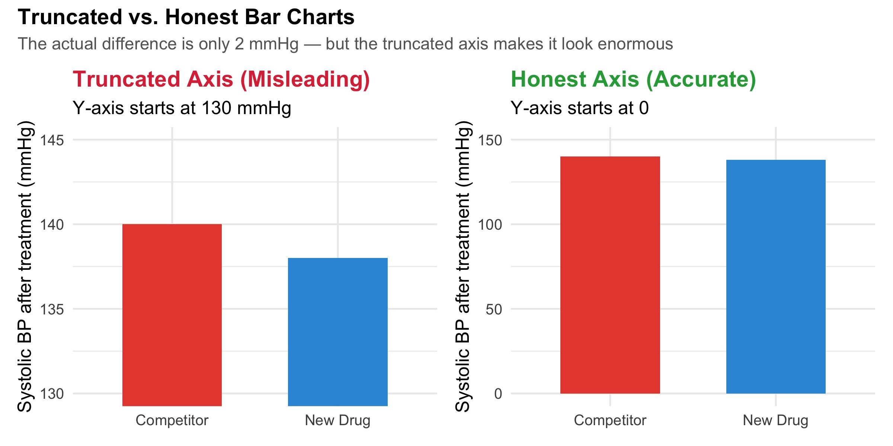

:::: content-callout1
## Readings

-    [Fundamentals of Data Visualization by Claus O. Wilke](https://clauswilke.com/dataviz/)
-    [R for Data Science (2e) was written by Hadley Wickham, Mine Çetinkaya-Rundel, and Garrett Grolemund. Chapter 10: Exploratory Data Analysis](https://r4ds.hadley.nz/EDA.html)

### Online/optional extras

-    [The R Graph Gallery](https://r-graph-gallery.com/index.html)
-    [ggplot2: Elegant Graphics for Data Analysis (3e) was written by Hadley Wickham, Danielle Navarro, and Thomas Lin Pedersen.](https://ggplot2-book.org/)
-    [Sim Daltonism: The color blindness simulator](https://michelf.ca/projects/sim-daltonism/)

## Questions/topics we'll address this week

1.  What are the fundamentals of data visualization?
2.  What is exploratory data analysis?

## Slides

[ Open slides in full screen mode](slides/w8-slides.html){.btn .btn-primary role="button"} [ Download slides as a PDF](slides/w8-slides.html?print-pdf){.btn .btn-primary role="button"}

<iframe src="slides/w8-slides.html" width="100%" height="500px" style="border: 1px solid #ccc; border-radius: 8px;">

</iframe>

::: callout-tip
**Tip**: If you type <kbd>?</kbd> (or <kbd>shift</kbd> + <kbd>/</kbd>) while going through the slides, you can see a list of special slide-specific commands.
:::
::::

</br>

```{r include=FALSE}
library(tidyverse)
```

## Fundamentals of Data Visualization
Last week we covered the technical side of creating data visualizations with ggplot. As you'll soon find out (if you haven't already), writing the code will quickly become the easy part -- making the plot and its message "click" is the tough part. There are tons of resources on doing this, and entire courses dedicated to just this topic, so our treatise of it will of course be surface-level only. Please check the course resources above for additional work (especially Claus Wilke's book on which many of the topics below are based), and check out Cory Hirsh's [Data Visualization in Plant and Microbial Biology](https://umtc.catalog.prod.coursedog.com/courses/8190201/tab-aoYks) (and the dozens of other data viz courses that exist on campus. I also may develop a dedicated workshop for Biology/Ecology in the coming year or two...).

## Priciples of Visualizations
With all of those different plots in mind, let's now talk about some of the general principles and theory around building effective, elegant visualizations. 

### Color use/pitfalls
Color is wonderful! But, it can also be distracting. When we build data visualizations, it's essential that we use color adequately and deliberately. There are a few general rules for color use:

1. **Color as a tool to distinguish:** use to distinquish discrete items or groups that don't have an intrinsic order (i.e., groups). Here, we use *qualitative* color scales where colors are selected to be distinct, but equivalent in their intensity, hue, etc.

{width="75%" fig-align="center"}

2. **Color to represent data values:** Here, color represents values such as temperature, precipitation, or some other continuous data that have a specific order. Here, we use a *sequential* color scale. This way, it is clear that colors indicate larger or smaller values and how distant to specific values are from one another. 

{width="75%" fig-align="center"}

:::{.indented-text}
In the event we are visualizing the deviation of values in two directions relative to a midpoint (most commonly 0), we use a *diverging* color scale.
:::

{width="75%" fig-align="center"}

3. **Color as a tool to highlight:** Sometimes we want to highlight specific elements in our dataset, such as specific categories or values that are essential for telling a particular story. Doing this will allow these elements to stand out relative to the other values and be immediately obvious to the reader. For these, we use *accent* color scales.

{width="75%" fig-align="center"}

A couple of quick pitfalls of color use:

1. **Encoding too much information to color:** Sometimes we think that color can do more than it's actually capable of and end up confusing or overwheming our audience/reader. Anything visualization with more than ~8 distinct colors in a qualitative scale and our brains basically give up. If we need to call-out specific values in this way, it's best to use *direct labeling* of points rather than color. 

```{r echo=FALSE}
library(tidyverse)

set.seed(123)

# Species and their ecological characteristics
species <- tibble(
  species = paste("Species", LETTERS[1:12]),
  guild = rep(
    c("Canopy", "Understory", "Generalist"),
    each = 4
  )
)

# Simulate bird survey observations
bird_data <- expand_grid(
  site = paste0("Site_", 1:20),
  habitat = c("Old-growth", "Secondary", "Regrowth", "Plantation"),
  species = species$species,
  season = c("Spring", "Summer", "Fall")
) |>
  left_join(species, by = "species") |>
  mutate(
    habitat_effect = case_when(
      habitat == "Old-growth" ~ 18,
      habitat == "Secondary" ~ 14,
      habitat == "Regrowth" ~ 10,
      habitat == "Plantation" ~ 6
    ),
    species_effect = match(species, unique(species)) %% 4 * 2,
    season_effect = case_when(
      season == "Spring" ~ 3,
      season == "Summer" ~ 6,
      TRUE ~ 1
    ),
    abundance = rpois(
      n(),
      lambda = habitat_effect +
        species_effect +
        season_effect
    )
  )
```

```{r echo=FALSE}
ggplot(
  bird_data,
  aes(
    x = habitat,
    y = abundance,
    color = species
  )
) +
  geom_jitter(
    width = 0.2,
    alpha = 0.8,
    size = 2.5
  ) +
  scale_color_brewer(palette = "Paired") +
  labs(
    title = "Bird abundance across forest habitats",
    subtitle = "Each species is assigned a different color",
    x = "Forest habitat",
    y = "Bird abundance",
    color = "Species"
  ) +
  theme_minimal(base_size = 12) +
  theme(
    plot.title = element_text(face = "bold"),
    legend.position = "right"
  )
```

### Principle of proportional ink
When we display data values as bar or other graphical elements that encode values through phsyical dimensions (think bar charts, bubble plots, maps, etc), it's essential that we avoid misleading presentation of our data. The sizes of shaded areas in a visualization need to be proportional to the data values they represent; this is known as the **principle of proportional ink**. Ink here referes to any part of the visualization that deviates from the background color (i.e., is derived from data).

This principle helps prevent misleading data visualizations by ensuring that: 

1. **Visual differences reflect numerical differences.** A value twice as large should generally look twice as large when represented by a size-based visual encoding.

2. **Graphs don't exaggerate differences.** Truncated axes in bar charts can make relatively small differences appear enormous.

3. **Visual comparisons remain intuitive.** Readers should be able to interpret relative magnitudes without being misled by graphical design choices.

Take this bar chart as an example: 

{width="100%" fig-align="center"}

:::{.callout-caution}
This figure is *also* misleading because it doens't represent any measure of variation around our value of systolic BP. We're presenting a mean value, but no sense of how *consistent* that value is across all of the reprentative samples it contains.
:::

### Design figures so they don't need a legend
Legends are great! But sometimes, they make us work harder than we need to by making us pull attention from one plot element to another and try to make connections between them. For example:

::: {layout="[1,1]"}


:::

Whenever possible, design your figures so that they don't need a legend! You can do this through *direct labeling*, or being smart about how we code our axes if we are mapping a single variable to multiple aesthetics at once. 

::: {layout="[1,1]"}


:::

### Balancing plot elements
As we put together our plots, it's important that we create visualizations that feel *balanced* with the amount of data that are potrayed relative to non-data elements (things like axes, tick marks, grid lines, legends, borders, background colors, etc.). 

This can cut two ways: we can both overload a plot with non-data ink which distracts and is ugly:
{width="75%" fig-align="center"}

Or take away too much non-data ink which decontextualizes our data and can make the plot harder to interpret:
{width="75%" fig-align="center"}

Creating balanced plots ultimately comes down to preference and is a skill you'll gain through time and by being open to feedback. There aren't hard and fast rules about this.

### Simplicity, simplicity, simplicity! 
This one is pretty simple, but also perhaps the most challenging to stick to. A simple visualization that communicates a central message well is always preferred over a complex, but beautiful visualization that muddies the message. Again, we return to the Great British Baking Show addage: style AND substance. When you have a dataset that you've worked tirelessly to collect, it's so tempting to try and show it off as much as you possibly can. That's understandable! But, it's more important to communicate a simple, effective message than to show everyone how much work you put into something. 

Some general tips on this end:
1. **Avoid gratuitous 3D useage (and 3D at all if possible):** 3D plots do one of two things on paper: look ugly, or struggle to convey your datas position adequately. If you need to use 3D (sometimes merited), you'll often need to animate your plot to be fully effective. More often than not, there are better ways to portray those data in 2 dimensions.

2. **Don't encode information simply because it's available in your dataset:** Not everything needs to be plotted simultaenously! Think carefully about what you chose to display.

3. **Consider whether the visualization works at a glance:** When reading a paper, I should be able to get the main take-away from the paper JUST by looking at the figures, their titles, and captions. 

4. **Build up toward complex figures:** This is particularly useful in presentations where we can ease folks into a complex visualization by first showing them a simplified version to help orient them to the axes and aesthetics. 

5. **Be consistent, but not repetitive:** Again, this more matters for presentations. Choose different visualization types for distinct analyses. People get fatigued looking at 15 of the exact same type of plot because you know how to create it. Choose the best plot for your type of data and what you want to convey, but don't feel like you must only use that plot forevermore.  

6. **Build your figures for the CEO:** I.e., people who are very busy and can't spend half an hour deciphering your plot. This is *especially* true for things like proposals, presentations, and reports. 

</br>

## Exploratory Data Analysis
After cleaning and wranglin' our data, exploratory data analysis is the next step toward understanding how your dataset is structured and to do the following:

- **Summarize main characteristics**: means of groups, variation, spread, normality, etc. 
- **Spot anomalies**: find odd data points, outliers, or miscoded data before it finds its way into an analysis. 
- **Find patterns**: these could be related to your central questions, or entirely unexpected patterns that manifest because of some real biological phenomenon, or because of some systematic bias in your data.

EDA can also help guide you toward questions that you can ask if you are working with a dataset that is purely correlative or from observational work rather than from a controlled, designed experiment. Even if you have data from a controlled experiment, EDA can still be a good way to explore interesting patterns outside of your pre-conceived hypotheses and experimental design. While there's no formal protocol on EDA, in general we want to do the following:

1. **Generate questions about your data**
2. **Search for answers by visualizing, transforming, and "modeling" your data**
3. **Use what you learn to refine questions and/or generate new questions**

### EDA checklist

| **EDA activity**              | **Questions to ask**                                                                                                                    |
| ----------------------------- | ------------------------------------------------------------------------------------------------------------------------------------------- |
| **Dataset structure**         | What are my observations? What does each row represent?                                                                                     |
| **Distributions**             | How are my variables distributed? Are they skewed, bimodal, or approximately normal?                                                        |
| **Missing data**              | Where and why are observations missing? Is missingness associated with particular groups, sites, or dates?                                  |
| **Sample sizes**              | Are observations balanced across groups, treatments, or sampling locations?                                                                 |
| **Variation**                 | How much variability exists within and among groups?                                                                                        |
| **Relationships**             | How are variables related to one another? Are relationships linear, nonlinear, or absent?                                                   |
| **Temporal patterns**         | Are there seasonal, annual, or other temporal trends?                                                                                       |
| **Spatial patterns**          | Are observations spatially clustered? Are there geographic patterns?                                                                        |
| **Outliers**                  | Are unusual observations errors, measurement artifacts, or meaningful biological variation?                                                 |
| **Sampling bias**             | Could differences in sampling effort, detectability, or methodology explain observed patterns?                                              |
| **Transformations**           | Would transforming variables or using alternative summaries help reveal patterns?                                                           |
| **Experimental design**       | Does the structure of my data reflect the experimental design? Am I accounting for blocks, sites, repeated measures, or other dependencies? |
| **Biological interpretation** | Are observed patterns biologically meaningful, or could they reflect statistical artifacts or confounding variables?                        |
| **New questions**             | What unexpected patterns have emerged? What additional questions should I investigate?                                                      |

:::{.callout-important}
If you are working with data from a carefully designed experiment (e.g., randomized complete block design), it's critical that we also analyze our data consistent with the manner in which the data were collected! EDA can help us ask additional questions, but we want to be sure to respect the work and purpose of the experimental design first and foremost. 
:::

:::{.callout-tip}
The `esquisse` package is an excellent tool for EDA if you don't want to have to repeatedly code up plots. It's an interactive GUI (graphical user interface) to build plots by dragging and dropping and toggling various features. In the end, it will generate the ggplot code for you that you can then put into your reports/markdown documents. 
:::

</br>

## A bestiary of plots
There's about a zillion different ways to display data. There's also many "right ways" and many "wrong ways", but often no single "best" way to build a plot. One of the best ways to brainstorm what sort of visualization you want to create for your data is to look around at what other folks have done. I have a whole folder in my paper library dedicated to excellent visualizations. This sort of thing is great to have in your back pocket to see what works well and what speaks to you aesthetically. 

Below are a whole bunch of different ways to display data of varying types. These were created by Claus Wilke, and he details how to create each of these plots in his online book, ["Fundamentals of Data Visualization"](https://clauswilke.com/dataviz/directory-of-visualizations.html) (see chapters 5-16). As you're buildng plots, this is an excellent place to start to see how the various ggplot calls are coded (i.e., what aesthetics and geoms they use, how their tibbles are structured, etc.). 

### Amounts
{width="100%"}
{width="100%"}

### Distributions
{width="100%"}
{width="100%"}

### Proportions
{width="100%"}
{width="100%"}
{width="100%"}

### Uncertainty
{width="100%"}
{width="100%"}
{width="100%"}

:::{.callout-important}
Any time you are plotting a mean value, either from a basic data summary, or a modeled value, it is **essential** that you also show the uncertainty around that value. The uncertainty calculations can include *standard deviations*, *standard errors*, and *confidence/credible intervals*
:::

### x-y relationships
{width="100%"}
{width="100%"}
{width="100%"}

### Geospatial data
{width="100%"}


